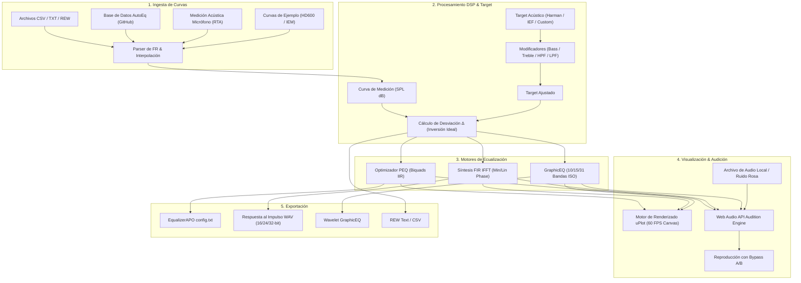

# Better-Autoeq 🎧⚡

> **Estación de trabajo web para ecualización, convolución FIR y análisis acústico de auriculares de alta precisión.**  
> *Una solución moderna, reactiva y multiplataforma inspirada y mejorada a partir de los flujos de trabajo de [jaakkopasanen/AutoEq](https://github.com/jaakkopasanen/AutoEq).*

---

[](https://www.solidjs.com/)
[](https://www.typescriptlang.org/)
[](https://tailwindcss.com/)
[](https://vitejs.dev/)
[](https://github.com/leeoniya/uPlot)
[](https://vitest.dev/)
[](LICENSE)

---

## 📑 Tabla de Contenidos

- [Visión General](#-visión-general)
- [Características Principales](#-características-principales)
  - [1. Motores de Ecualización Avanzados](#1-motores-de-ecualización-avanzados)
  - [2. Targets Acústicos y Personalización Fina](#2-targets-acústicos-y-personalización-fina)
  - [3. Base de Datos Integrada AutoEq](#3-base-de-datos-integrada-autoeq)
  - [4. Audición en Tiempo Real (A/B Testing)](#4-audición-en-tiempo-real-ab-testing)
  - [5. Analizador Acústico RTA y Captura con Micrófono](#5-analizador-acústico-rta-y-captura-con-micrófono)
  - [6. Soporte Táctil y Gestos Capacitivos](#6-soporte-táctil-y-gestos-capacitivos)
  - [7. Formatos de Exportación Universales](#7-formatos-de-exportación-universales)
- [Arquitectura del Sistema](#-arquitectura-del-sistema)
- [Stack Tecnológico](#-stack-tecnológico)
- [Estructura del Proyecto](#-estructura-del-proyecto)
- [Instalación y Puesta en Marcha](#-instalación-y-puesta-en-marcha)
- [Guía Rápida de Uso](#-guía-rápida-de-uso)
- [Guía de Solución de Problemas (Troubleshooting)](#-guía-de-solución-de-problemas-troubleshooting)
  - [Acceso al micrófono en móviles bajo red local (HTTP)](#acceso-al-micrófono-en-móviles-bajo-red-local-http)
  - [Prevención de distorsión digital (Clipping)](#prevención-de-distorsión-digital-clipping)
- [Contribuir](#-contribuir)
- [Créditos y Reconocimientos](#-créditos-y-reconocimientos)

---

## 🌟 Visión General

**Better-Autoeq** es una aplicación web de audio profesional orientada a audiófilos, ingenieros acústicos y entusiastas del sonido. Permite analizar la respuesta en frecuencia de cualquier auricular, comparar curvas frente a estándares de la industria, optimizar ecualizaciones paramétricas (PEQ) o filtros de convolución FIR mediante procesamiento digital de señales (DSP), y escuchar el resultado en vivo directamente en el navegador sin instalar controladores adicionales ni ejecutar scripts de consola.

### ¿Por qué Better-Autoeq?

| Característica | AutoEq Tradicional (Python CLI) | Herramientas Web Previas | **Better-Autoeq** |
| :--- | :---: | :---: | :---: |
| **Tiempo de respuesta** | Por lotes / Procesamiento offline | Lento / Renderizado SVG pesado | **Reactividad instantánea (SolidJS + uPlot 60 FPS)** |
| **Preescucha de audio** | ❌ No disponible | ❌ No disponible o muy básica | **Motor Web Audio en vivo (Biquad + Convolver)** |
| **Generación FIR WAV** | Requiere script Python manual | ⚠️ Rara vez implementado en cliente | **Síntesis IFFT directa (16/24/32-bit, Min/Lin Phase)** |
| **Medición con micrófono** | ❌ Requiere REW u otros programas | ❌ No | **RTA integrado con reducción diferencial de ruido** |
| **Soporte Móvil & Táctil** | ❌ Solo escritorio | ⚠️ Interfaz rígida de escritorio | **Diseño 100% responsivo + Gestos capacitivos (Pinch/Pan)** |
| **Persistencia** | Archivos locales sueltos | ❌ Pérdida al refrescar | **Sincronización tolerante a fallos en LocalStorage** |

---

## 🚀 Características Principales

### 1. Motores de Ecualización Avanzados

Better-Autoeq integra cuatro enfoques de compensación acústica:

- **Parametric EQ (PEQ) Automático**:
  - Ajuste iterativo de filtros bicuadráticos IIR de segundo orden (*Peaking / PK*, *Low-Shelf / LSC*, *High-Shelf / HSC*, *High-Pass / HP*, *Low-Pass / LP*).
  - Algoritmo de minimización de error cuadrático ponderado para alcanzar el target con la mínima cantidad necesaria de filtros (configurable de 1 a 20 bandas).
  - Cálculo automático de *Preamp* negativo para salvaguardar el margen dinámico (*headroom*) y prevenir saturación digital inter-sample.
- **Convolución FIR (Impulse Response)**:
  - Generación matemática de respuestas al impulso de alta resolución mediante transformada inversa rápida de Fourier (IFFT).
  - Soporte de resolución de **1,024 a 65,536 taps**.
  - Modos de fase seleccionables: **Fase Mínima (Minimum Phase)** para latencia ultrabaja sin pre-ringing, y **Fase Lineal (Linear Phase)** para preservar relaciones de fase perfectas.
- **Graphic EQ Interactivo**:
  - Ecualizador gráfico de estándar ISO con selectores de **10, 15 o 31 bandas**.
  - Deslizadores verticales con aislamiento táctil estricto para evitar conflictos con el scroll de la página.
  - Sincronización bidireccional con formatos de cadena de texto de Wavelet y EqualizerAPO.
- **Inversión Matemática Ideal**:
  - Cálculo continuo de la diferencia diferencial espectral pura $\Delta(f) = \text{Target}(f) - \text{Medición}(f)$.

---

### 2. Targets Acústicos y Personalización Fina

Incluye las curvas objetivo más reconocidas en investigación acústica psicoacústica:

- **Harman Over-Ear 2019** (Auriculares circumaurales y supraaurales).
- **Harman In-Ear v2 2019** (Auriculares intrauditivos / IEMs).
- **IEF Neutral** (Curva de referencia neutral de In-Ear Fidelity).
- **Campo Difuso (Diffuse Field)** y **Campo Libre (Free Field)**.
- **Carga de Targets Personalizados**: Importación de archivos `.txt`, `.csv` o formatos de Room EQ Wizard (REW).

#### Parámetros de Ajuste Dinámico del Target

- **Bass Boost**: Ganancia ($\pm 12\text{ dB}$), Frecuencia central $F_c$ ($20 - 200\text{ Hz}$) y Factor de calidad $Q$.
- **Treble Shelf**: Ganancia ($\pm 12\text{ dB}$), Frecuencia central $F_c$ ($2 - 16\text{ kHz}$) y Factor de calidad $Q$.
- **Treble Tilt**: Inclinación continua en dB/octava pivotada en $1\text{ kHz}$.
- **Filtros Pasa Altos (HPF) y Pasa Bajos (LPF)**: Pendientes seleccionables de $6, 12, 18, 24, 36\text{ y }48\text{ dB/oct}$, con topologías **Butterworth**, **Linkwitz-Riley**, **Bessel** o personalizada.
- **Limitador de agudos**: Atenuación opcional de realces agresivos por encima de los $10\text{ kHz}$.

---

### 3. Base de Datos Integrada AutoEq

Acceso directo a miles de mediciones de auriculares sin salir de la aplicación:

- Conexión e indexación en caliente con el repositorio oficial [jaakkopasanen/AutoEq](https://github.com/jaakkopasanen/AutoEq).
- Mediciones de rig acústicos profesionales: **Crinacle** (711 y BK5128), **Oratory1990**, **Rtings**, **Innerfidelity**, **Super* Review**, **Reference Audio Analyzer**, etc.
- Búsqueda en tiempo real con filtrado por fabricante, modelo y fuente de medición.
- Descarga y graficado con un solo clic.

---

### 4. Audición en Tiempo Real (A/B Testing)

- **Motor Web Audio API nativo**: Las curvas generadas se inyectan en tiempo real en una cadena de nodos `BiquadFilterNode` o `ConvolverNode`.
- **Selector de fuentes de audio**:
  - Carga de pistas de audio locales en formatos **MP3, WAV, FLAC, OGG o AAC**.
  - Generador sintético integrado de **Ruido Rosa (Pink Noise)** y **Ruido Blanco (White Noise)** para evaluación crítica de balance tonal.
- **Bypass Instantáneo (A/B)**: Alterna entre el sonido ecualizado y el sonido original sin artefactos de desconexión para evaluar de forma certera la mejora psicoacústica.
- **Compensación de Ganancia**: Control de volumen maestro con indicador de ganancia efectiva para evitar diferencias de volumen percibido (Loudness Bias).

---

### 5. Analizador Acústico RTA y Captura con Micrófono

- **Real-Time Analyzer (RTA)**: Captura continua de la señal acústica ambiental o de acoplamiento auricular mediante micrófono.
- **DSP de análisis**:
  - Transformada rápida de Fourier (FFT) configurable de 512 a 16,384 puntos.
  - Ventanas espectrales: **Hanning**, **Hamming** y **Blackman**.
  - Modos de promediado: Instantáneo, Exponencial y Retención de Picos (*Peak Hold*).
- **Captura Diferencial de Ruido**: Permite grabar el suelo de ruido ambiental de fondo de la habitación y restarlo matemáticamente del espectro para obtener mediciones limpias.
- **Generador de Barrido (Sweep)**: Generación de tonos senoidales logarítmicos para medición de respuesta en frecuencia acústica.
- **Resiliencia en Contextos Móviles**: Detección inteligente de contextos seguros (`isSecureContext`) y guías de configuración para pruebas en red local bajo `HTTP`.

---

### 6. Soporte Táctil y Gestos Capacitivos

Diseñado y optimizado desde cero tanto para monitores de escritorio como para pantallas táctiles de portátiles, tablets y smartphones:

- 👆 **Seguimiento con 1 dedo**: Desliza el dedo por el gráfico para visualizar la mira (*crosshair*), frecuencia exacta y valor en dB SPL.
- ✌️ **Pellizco y Desplazamiento (Pinch-to-Zoom & Pan) con 2 dedos**: Haz zoom logarítmico suave entre $20\text{ Hz}$ y $20\text{ kHz}$ y desplaza el rango de frecuencias horizontalmente de manera natural.
- ⚡ **Doble toque rápido (Double-Tap)**: Restablece de inmediato el zoom y el encuadre de frecuencias predeterminado.
- 📱 **Diseño de Interfaz Adaptativo**:
  - Cajón lateral (*Drawer*) deslizante con fondo translúcido (*backdrop blur*) para pantallas móviles.
  - Pestañas compactas para alternar entre "Ajustes Target" y "Método de Ecualización".
  - Áreas de toque aumentadas según estándares de accesibilidad (mínimo 44x44 px) y aislamiento de eventos `pointer: coarse`.

---

### 7. Formatos de Exportación Universales

Exporta tu perfil de calibración con un clic hacia cualquier software o reproductor del ecosistema audiófilo:

| Formato / Destino | Extensión / Tipo | Descripción |
| :--- | :---: | :--- |
| **EqualizerAPO** | `.txt` | Archivo `config.txt` con comandos `Preamp:` y filtros paramétricos `Filter: ON PK/LSC/HSC Fc Q Gain`. |
| **Wavelet / Android** | `.txt` | Cadena estándar `GraphicEQ: 20 0.0; 25 -1.2; ...` con 127 puntos logarítmicos exactos. |
| **Impulso de Convolución FIR** | `.wav` | Archivo de audio WAV sin pérdidas, con selección de frecuencia de muestreo (**44.1, 48, 88.2, 96 o 192 kHz**), profundidad de bits (**16-bit PCM, 24-bit PCM, 32-bit Float**), canales (**Mono o Estéreo**) y normalización anti-clipping. Compatible con **Roon**, **CamillaDSP**, **HQPlayer**, **EasyEffects** y **Convolver**. |
| **Room EQ Wizard (REW)** | `.txt` | Formato de texto estándar de frecuencias y SPL compatible con REW y analizadores acústicos. |
| **CSV Multipropósito** | `.csv` | Tabla separada por comas con todas las curvas activas (Medición, Target, Ecualización y Resultado). |

---

## 📐 Arquitectura del Sistema

El siguiente diagrama ilustra el flujo de datos y procesamiento de señales dentro de la aplicación:



---

## 🛠️ Stack Tecnológico

- **Núcleo & UI**: [SolidJS](https://www.solidjs.com/) v1.9 — Rendimiento reactivo sin Virtual DOM.
- **Lenguaje**: [TypeScript](https://www.typescriptlang.org/) v6.0 — Tipado estricto en algoritmos de audio y DSP.
- **Herramienta de Construcción**: [Vite](https://vitejs.dev/) v8.3 — HMR instantáneo y empaquetado optimizado.
- **Estilos & Diseño**: [Tailwind CSS](https://tailwindcss.com/) v4 — Diseño moderno con variables CSS y paleta OKLab para audio profesional.
- **Visualización Gráfica**: [uPlot](https://github.com/leeoniya/uPlot) v1.6 — Gráficos Canvas 2D ultrarrápidos con interpolación logarítmica y soporte para 60+ FPS.
- **Iconografía**: [Lucide Solid](https://lucide.dev/) — Iconos SVG limpios y consistentes.
- **Procesamiento de Audio**: [Web Audio API](https://developer.mozilla.org/en-US/docs/Web/API/Web_Audio_API) nativo del navegador.
- **Testing**: [Vitest](https://vitest.dev/) v5.0 — Pruebas unitarias para persistencia, parseo, DSP y captura de audio.

---

## 📂 Estructura del Proyecto

```text
Better-Autoeq/
├── public/                     # Recursos estáticos (favicons, SVG)
├── src/
│   ├── components/             # Componentes de interfaz de usuario (SolidJS)
│   │   ├── AutoEq/             # Panel de control de ecualización y parámetros target
│   │   ├── Chart/              # Gráfico interactivo uPlot y gestos multitáctiles
│   │   ├── Common/             # Popovers, selectores de color e interfaces comunes
│   │   ├── Export/             # Diálogo modal de exportación multi-formato
│   │   ├── Header/             # Barra de herramientas, reproductor de audio y bypass
│   │   ├── Mic/                # Modal de medición RTA y gráfico de espectro FFT
│   │   └── Sidebar/            # Lista de curvas, gestión y explorador de AutoEq DB
│   ├── lib/                    # Librerías de lógica pura, matemáticas y DSP
│   │   ├── audio/              # Motor de audición, FFT, codificador WAV y captura de micro
│   │   ├── autoeq/             # Filtros biquad, optimizador PEQ, convolución FIR, targets
│   │   ├── chart/              # Medidor de FPS y utilidades de renderizado
│   │   ├── parser/             # Parseo robusto de respuestas en frecuencia (.csv, .txt)
│   │   └── storage/            # Persistencia en LocalStorage con tolerancia a corrupción
│   ├── store/                  # Estado reactivo global de la aplicación (frStore.ts)
│   ├── App.tsx                 # Contenedor principal con diseño responsivo
│   ├── index.css               # Estilos globales y utilidades táctiles de Tailwind v4
│   └── index.tsx               # Punto de entrada de la aplicación
├── tests/                      # Suite de pruebas unitarias (Vitest)
├── package.json                # Dependencias y scripts de ejecución
├── tsconfig.json               # Configuración de compilación TypeScript
└── vite.config.ts              # Configuración de Vite y plugins
```

---

## 💻 Instalación y Puesta en Marcha

### Prerrequisitos

- [Node.js](https://nodejs.org/) v18.0.0 o superior.
- Gestor de paquetes `npm`, `pnpm` o `yarn`.

### 1. Clonar el Repositorio

```bash
git clone https://github.com/tu-usuario/Better-Autoeq.git
cd Better-Autoeq
```

### 2. Instalar Dependencias

```bash
npm install
```

### 3. Iniciar el Servidor de Desarrollo

```bash
npm run dev
```

La aplicación iniciará por defecto en `http://localhost:5173`. Si deseas acceder desde tu teléfono móvil o tablet en la misma red Wi-Fi, Vite expondrá la dirección IP local de tu máquina.

### 4. Ejecutar las Pruebas Unitarias

```bash
npm run test
```

### 5. Compilar para Producción

```bash
npm run build
```

Los archivos optimizados y minificados se generarán en la carpeta `dist/`.

### 6. Previsualizar la Compilación de Producción

```bash
npm run preview
```

---

## 📖 Guía Rápida de Uso

1. **Seleccionar o Cargar Auriculares**:
   - Pulsa sobre **"Base de Datos AutoEq"** para buscar el modelo exacto de tus auriculares, o arrastra un archivo `.txt` / `.csv` al panel de curvas.
2. **Definir la Curva Objetivo (Target)**:
   - Elige entre *Harman Over-Ear*, *Harman In-Ear*, *IEF Neutral* o carga tu propia referencia.
   - Modifica el *Bass Boost* o el *Treble Tilt* según tu preferencia personal.
3. **Escoger el Modo de Ecualización**:
   - Selecciona **PEQ** para generar filtros paramétricos automáticos de bajo consumo para EqualizerAPO.
   - O selecciona **FIR** para generar una convolución perfecta con respuesta al impulso de fase lineal o mínima.
4. **Preescuchar y Validar**:
   - Carga una canción de tu biblioteca en el reproductor de la barra superior.
   - Presiona **Play** y utiliza el botón **Bypass (A/B)** para evaluar instantáneamente la ganancia en claridad, balance y escena sonora.
5. **Exportar**:
   - Haz clic en **Exportar**.
   - Descarga el archivo de configuración para tu reproductor de preferencia (Wavelet en Android, EqualizerAPO en Windows, o archivo WAV para convolución en Roon / CamillaDSP).

---

## 🔧 Guía de Solución de Problemas (Troubleshooting)

### Acceso al micrófono en móviles bajo red local (HTTP)

Los navegadores móviles modernos bloquean por seguridad el acceso a la cámara y micrófono (`navigator.mediaDevices.getUserMedia`) si el sitio no proviene de un origen seguro (`HTTPS` o `localhost`).

Si estás probando el servidor de desarrollo en tu teléfono móvil vía Wi-Fi (ejemplo: `http://192.168.1.16:5173`):

1. Abre **Google Chrome** en tu smartphone.
2. Escribe en la barra de direcciones: `chrome://flags/#unsafely-treat-insecure-origin-as-secure`
3. Habilita la opción e introduce la URL de tu servidor (ej. `http://192.168.1.16:5173`).
4. Reinicia Chrome. ¡La captura RTA funcionará con total normalidad!

### Prevención de distorsión digital (Clipping)

Al aplicar realces positivos de ecualización (por ejemplo $+6\text{ dB}$ en sub-graves), la señal puede superar los $0\text{ dBFS}$ digitales, causando saturación o *clipping*.

- Better-Autoeq calcula automáticamente el **Preamp negativo necesario** ($-\text{Pico Máximo} - 0.2\text{ dB}$ de margen de seguridad).
- Asegúrate de incluir la línea de `Preamp` generada al pegar la configuración en EqualizerAPO o tu DSP predilecto.

---

## 🤝 Contribuir

¡Las contribuciones, sugerencias y mejoras son bienvenidas!

1. Haz un Fork del proyecto.
2. Crea tu rama de funcionalidad (`git checkout -b feature/nueva-mejora`).
3. Realiza tus cambios y verifica que las pruebas pasen (`npm run test && npm run build`).
4. Haz Commit de tus cambios (`git commit -m 'feat: añadir soporte para nuevo formato de exportación'`).
5. Empuja la rama (`git push origin feature/nueva-mejora`).
6. Abre un **Pull Request**.

---

## 🏆 Créditos y Reconocimientos

- **[Jaakko Pasanen](https://github.com/jaakkopasanen)** por la creación de [AutoEq](https://github.com/jaakkopasanen/AutoEq), pionero en la ecualización algorítmica de auriculares.
- **Dr. Sean Olive y Harman International** por las investigaciones empíricas sobre las preferencias acústicas del oído humano (Harman Target).
- **[Crinacle](https://crinacle.com)**, **[Oratory1990](https://www.reddit.com/r/oratory1990/)**, **[Rtings](https://www.rtings.com)** y **Super* Review** por sus bases de datos y aportes indispensables al mundo del audio personal.
- **[Leon Sorokin (leeoniya)](https://github.com/leeoniya/uPlot)** por crear `uPlot`, la librería de visualización en canvas más rápida y eficiente de la web.

---

<p align="center">
  Hecho con ❤️ para la comunidad audiófila y amantes de la alta fidelidad.
</p>
